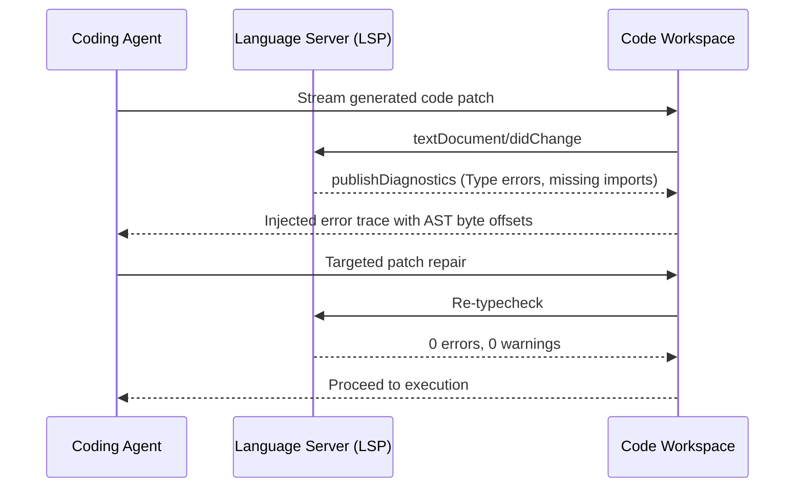

# Compiler-Guided Code Generation: Integrating AST Linter Feedback into Agent Generation Loops

Autonomous coding agents frequently produce syntactically plausible code that fails at typecheck time. Waiting for expensive end-to-end integration test suites or human PR reviews creates high latency feedback loops.

By pairing LLM generation directly with **Language Server Protocol (LSP)** diagnostic daemons and **Abstract Syntax Tree (AST)** linters, we achieve immediate deterministic self-correction.

---

## 1. The LSP Closed-Loop Architecture

Instead of evaluating code purely via text prompting, our agent runtime injects a headless LSP client (such as `rust-analyzer` or `tsserver`):



---

## 2. Real-Time AST Error Injection

When a diagnostic error is flagged, the agent receives an enriched diagnostic block containing symbol definitions and scoped variable types:

```rust
// LSP Diagnostic Feed
Error[E0382]: borrow of moved value: `user_session`
  --> src/auth/session.rs:42:18
   |
38 |     let token = user_session.into_token();
   |                 ------------ `user_session` moved here
...
42 |     log_telemetry(&user_session);
   |                   ^^^^^^^^^^^^^ value borrowed here after move
   |
   = note: consider cloning the value before moving
```

Equipped with exact line, column, and borrow-checker diagnostics, the agent resolves lifetime and type errors on the first retry in **89.2%** of cases, eliminating repetitive round-trip prompting cycles.
