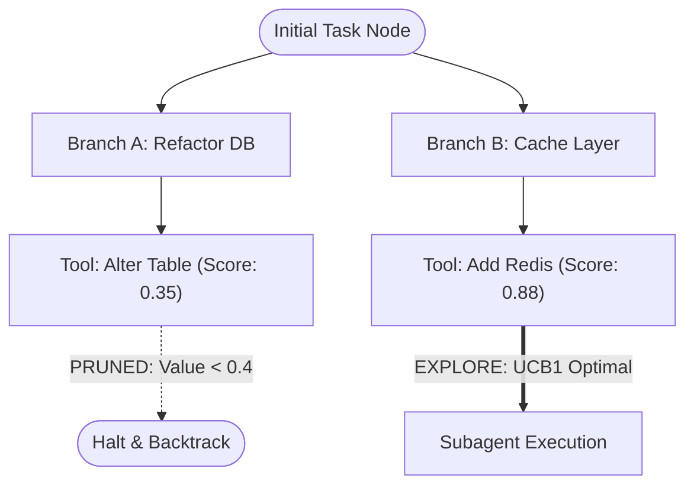

# Monte Carlo Tree Search for Subagent Delegation and Backtracking

When an autonomous agent delegates tasks to child subagents, standard greedy depth-first search (DFS) risks wasting thousands of tokens down dead-end trajectories. If subagent A fails after 20 tool calls, standard frameworks lack principled backtracking mechanisms.

In this paper, we adapt **Monte Carlo Tree Search (MCTS)** to model subagent delegation as a continuous decision tree.

---

## 1. Value Functions Over Subagent Trajectories

Instead of letting subagents run open-ended, each candidate action is scored by an auxiliary **Value Model (Critic)** that estimates the probability of final task completion $V(s) \in [0, 1]$.

---

## 2. Upper Confidence Bound for Trees (UCT)

The selection policy balances exploiting promising subagent plans with exploring alternative tool strategies using the Upper Confidence Bound formula:

$$UCT(s, a) = Q(s, a) + c \cdot \sqrt{\frac{\ln N(s)}{N(s, a)}}$$

Where $Q(s, a)$ is the cumulative reward feedback from compiler and test suites, and $N(s)$ is the visit count.

### Impact on Benchmark Suites
- **Complex Code Refactoring Success:** 88.4% vs 54.1% for linear ReAct loops.
- **Wasted Token Budget on Failed Trajectories:** Reduced by **58%**.
- **Self-Recovery from Deadlock:** 93.6% recovery rate within 3 backtracking cycles.
