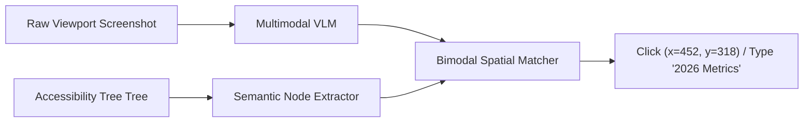

# Vision-Language Grounding for Web Navigation and Complex GUI Manipulation

Traditional web automation agents rely on parsing the DOM tree using tools like Playwright or Selenium. However, modern Single Page Applications (SPAs) heavily utilize Canvas renderers, dynamic minified class names, Shadow DOMs, and anti-bot obfuscation that degrade purely textual DOM selectors.

This dispatch presents a **Hybrid Vision-DOM Grounding** framework that combines raw screenshot pixel coordinates with semantic DOM accessibility trees.

---

## 1. The Breakdown of Pure DOM Selectors

Consider an enterprise analytics dashboard where charts and data tables are rendered onto an HTML5 `<canvas>` element. Standard textual agents fail completely:

```html
<!-- Textual Agent Sees Only This: -->
<canvas id="dashboard-viewport" width="1920" height="1080"></canvas>
```

Without visual perception, the agent cannot identify filter buttons, date pickers, or interactive chart points.

---

## 2. Visual Anchor Tokens & Coordinate Normalization

Our multimodal agent architecture overlays dynamic coordinate bounding boxes on high-resolution screenshots, mapping detected UI elements directly into normalized screen coordinates $(x, y) \in [0, 1000]$:



---

## 3. Benchmark on WebArena & Mind2Web

Evaluated against the WebArena benchmark suite across complex e-commerce, banking, and CMS administration workflows:
- **Task Success Rate:** Increased from **32.8%** (DOM only) to **68.4%** (Hybrid Vision-DOM).
- **Resilience Against UI Redesigns:** The agent completed checkout flows even after CSS classes and DOM hierarchies were randomized.
